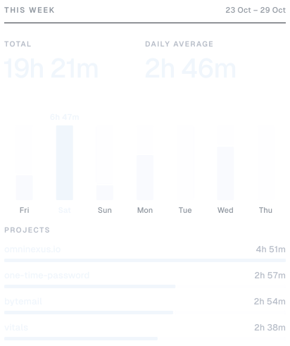
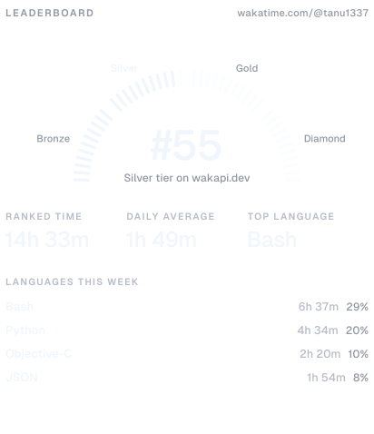
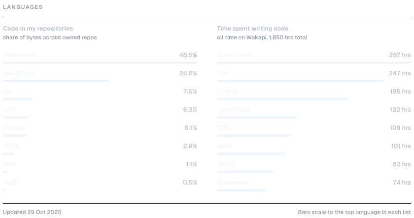
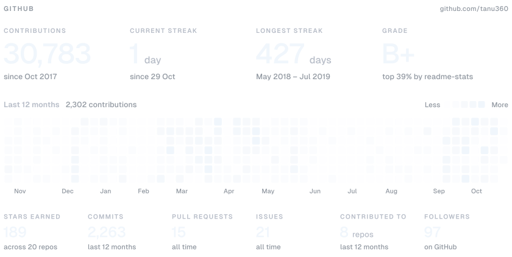
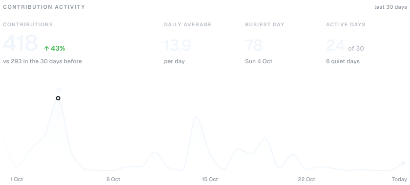
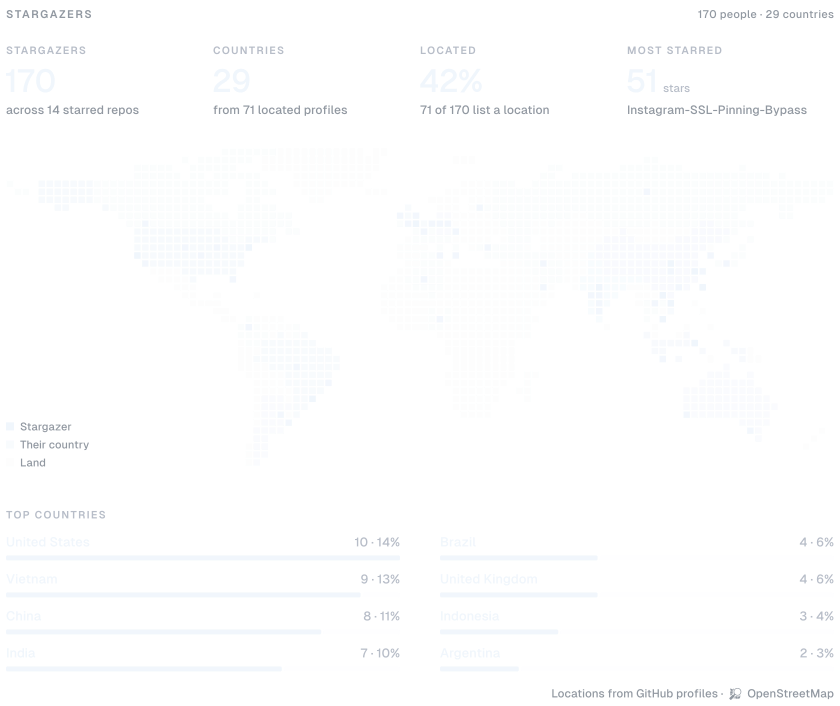
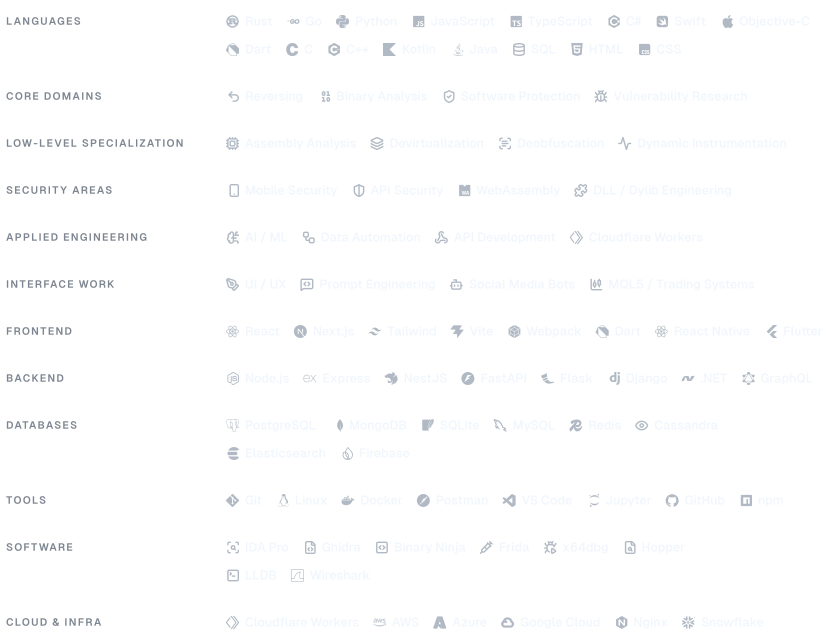

<picture><source media="(prefers-color-scheme: dark)" srcset="./profile/hero-dark.svg" /><source media="(prefers-color-scheme: light)" srcset="./profile/hero-light.svg" /></picture>

> **Renaissance-class** offensive security researcher with demonstrated **global top-tier depth** in multiple **rare niches** and **shipped production engineering** capability.

<picture><source media="(prefers-color-scheme: dark)" srcset="./profile/section-about-dark.svg" /><source media="(prefers-color-scheme: light)" srcset="./profile/section-about-light.svg" /></picture>

I work across **cybersecurity**, **AI/ML**, **software protection**, and **low-level engineering** — with a focus on problems that demand both depth and breadth. My core work spans reverse engineering and binary analysis across Windows, macOS, Linux, Android, and iOS; software protection research on commercial protectors and virtualization systems; mobile application security including native library analysis and runtime instrumentation; and API protocol analysis with authentication internals and anti-bot research.

Beyond security, I build AI-powered products, real-time data pipelines, developer tools, and scalable backend systems. My work spans from native code and assembly-level analysis to full-stack product development — I'm comfortable anywhere on the stack, and most drawn to hard engineering problems where the interesting answers live below the surface.

I'm open to serious collaboration around **security consulting**, **software protection engineering**, **AI/ML tooling**, **data infrastructure**, and **developer automation**.

  <picture><source media="(prefers-color-scheme: dark)" srcset="./profile/about-cyber-dark.svg" /><source media="(prefers-color-scheme: light)" srcset="./profile/about-cyber-light.svg" /></picture>
  <picture><source media="(prefers-color-scheme: dark)" srcset="./profile/about-reversing-dark.svg" /><source media="(prefers-color-scheme: light)" srcset="./profile/about-reversing-light.svg" /></picture>
  <picture><source media="(prefers-color-scheme: dark)" srcset="./profile/about-protection-dark.svg" /><source media="(prefers-color-scheme: light)" srcset="./profile/about-protection-light.svg" /></picture>
  <picture><source media="(prefers-color-scheme: dark)" srcset="./profile/about-aiml-dark.svg" /><source media="(prefers-color-scheme: light)" srcset="./profile/about-aiml-light.svg" /></picture>
  <picture><source media="(prefers-color-scheme: dark)" srcset="./profile/about-coding-dark.svg" /><source media="(prefers-color-scheme: light)" srcset="./profile/about-coding-light.svg" /></picture>

 

<picture><source media="(prefers-color-scheme: dark)" srcset="./profile/section-coding-dark.svg" /><source media="(prefers-color-scheme: light)" srcset="./profile/section-coding-light.svg" /></picture>

  <a href="https://wakatime.com/@tanu1337"><picture><source media="(prefers-color-scheme: dark)" srcset="./profile/week-dark.svg" /><source media="(prefers-color-scheme: light)" srcset="./profile/week-light.svg" /></picture></a>
  <a href="https://wakatime.com/@tanu1337"><picture><source media="(prefers-color-scheme: dark)" srcset="./profile/rank-dark.svg" /><source media="(prefers-color-scheme: light)" srcset="./profile/rank-light.svg" /></picture></a>

<picture><source media="(prefers-color-scheme: dark)" srcset="./profile/languages-dark.svg" /><source media="(prefers-color-scheme: light)" srcset="./profile/languages-light.svg" /></picture>

 

<picture><source media="(prefers-color-scheme: dark)" srcset="./profile/section-github-dark.svg" /><source media="(prefers-color-scheme: light)" srcset="./profile/section-github-light.svg" /></picture>

<a href="https://github.com/tanu360"><picture><source media="(prefers-color-scheme: dark)" srcset="./profile/github-dark.svg" /><source media="(prefers-color-scheme: light)" srcset="./profile/github-light.svg" /></picture></a>

<picture><source media="(prefers-color-scheme: dark)" srcset="./profile/activity-dark.svg" /><source media="(prefers-color-scheme: light)" srcset="./profile/activity-light.svg" /></picture>

<picture><source media="(prefers-color-scheme: dark)" srcset="./profile/stargazers-dark.svg" /><source media="(prefers-color-scheme: light)" srcset="./profile/stargazers-light.svg" /></picture>

 

<picture><source media="(prefers-color-scheme: dark)" srcset="./profile/section-skills-dark.svg" /><source media="(prefers-color-scheme: light)" srcset="./profile/section-skills-light.svg" /></picture>

<picture><source media="(prefers-color-scheme: dark)" srcset="./profile/skills-dark.svg" /><source media="(prefers-color-scheme: light)" srcset="./profile/skills-light.svg" /></picture>

 

<picture><source media="(prefers-color-scheme: dark)" srcset="./profile/section-work-dark.svg" /><source media="(prefers-color-scheme: light)" srcset="./profile/section-work-light.svg" /></picture>

<a href="https://github.com/tanu360/ida-chat-plugin"><picture><source media="(prefers-color-scheme: dark)" srcset="./profile/work-ida-chat-plugin-dark.svg" /><source media="(prefers-color-scheme: light)" srcset="./profile/work-ida-chat-plugin-light.svg" /></picture></a> 
<a href="https://github.com/tanu360/nanobananademo"><picture><source media="(prefers-color-scheme: dark)" srcset="./profile/work-nanobananademo-dark.svg" /><source media="(prefers-color-scheme: light)" srcset="./profile/work-nanobananademo-light.svg" /></picture></a> 
<a href="https://github.com/tanu360/claude-code-dashboard"><picture><source media="(prefers-color-scheme: dark)" srcset="./profile/work-claude-code-dashboard-dark.svg" /><source media="(prefers-color-scheme: light)" srcset="./profile/work-claude-code-dashboard-light.svg" /></picture></a> 
<a href="https://github.com/tanu360/Facebook-SSL-Pinning-Bypass"><picture><source media="(prefers-color-scheme: dark)" srcset="./profile/work-facebook-ssl-pinning-bypass-dark.svg" /><source media="(prefers-color-scheme: light)" srcset="./profile/work-facebook-ssl-pinning-bypass-light.svg" /></picture></a> 
<a href="https://github.com/tanu360/Instagram-SSL-Pinning-Bypass"><picture><source media="(prefers-color-scheme: dark)" srcset="./profile/work-instagram-ssl-pinning-bypass-dark.svg" /><source media="(prefers-color-scheme: light)" srcset="./profile/work-instagram-ssl-pinning-bypass-light.svg" /></picture></a> 
<a href="https://github.com/tanu360/apple-intelligence-api"><picture><source media="(prefers-color-scheme: dark)" srcset="./profile/work-apple-intelligence-api-dark.svg" /><source media="(prefers-color-scheme: light)" srcset="./profile/work-apple-intelligence-api-light.svg" /></picture></a> 
<a href="https://github.com/tanu360/chatjimmy-reverse-api"><picture><source media="(prefers-color-scheme: dark)" srcset="./profile/work-chatjimmy-reverse-api-dark.svg" /><source media="(prefers-color-scheme: light)" srcset="./profile/work-chatjimmy-reverse-api-light.svg" /></picture></a> 
<a href="https://github.com/tanu360/facebook-checker-v4"><picture><source media="(prefers-color-scheme: dark)" srcset="./profile/work-facebook-checker-v4-dark.svg" /><source media="(prefers-color-scheme: light)" srcset="./profile/work-facebook-checker-v4-light.svg" /></picture></a> 

 

  <a href="https://github.com/tanu360"><picture><source media="(prefers-color-scheme: dark)" srcset="./profile/connect-github-dark.svg" /><source media="(prefers-color-scheme: light)" srcset="./profile/connect-github-light.svg" /></picture></a>
  &nbsp;&nbsp;
  <a href="https://github.com/tanu360?tab=repositories"><picture><source media="(prefers-color-scheme: dark)" srcset="./profile/connect-repos-dark.svg" /><source media="(prefers-color-scheme: light)" srcset="./profile/connect-repos-light.svg" /></picture></a>
  &nbsp;&nbsp;
  <a href="https://gist.github.com/tanu360"><picture><source media="(prefers-color-scheme: dark)" srcset="./profile/connect-gists-dark.svg" /><source media="(prefers-color-scheme: light)" srcset="./profile/connect-gists-light.svg" /></picture></a>
  &nbsp;&nbsp;
  <a href="https://wakatime.com/@tanu1337"><picture><source media="(prefers-color-scheme: dark)" srcset="./profile/connect-wakatime-dark.svg" /><source media="(prefers-color-scheme: light)" srcset="./profile/connect-wakatime-light.svg" /></picture></a>

<picture><source media="(prefers-color-scheme: dark)" srcset="./profile/updated-dark.svg" /><source media="(prefers-color-scheme: light)" srcset="./profile/updated-light.svg" /></picture>

